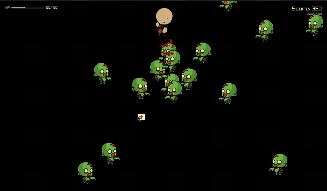

# Just Live!

[](https://github.com/eswar-7116/justlive/releases/latest)
[](https://github.com/eswar-7116/justlive/actions/workflows/go.yml)
[](LICENSE)

A top-down zombie survival shooter written in Go with [raylib](https://www.raylib.com/).

Zombies pour in from every edge of the screen, faster and faster. Shoot, dash, grab drops, and **just live** as long as you can.

<p align="center">
  
</p>

---

## Features

- **Endless waves**: zombies spawn faster over time and speed up every 50 points
- **Dash** through the crowd with a short cooldown, knocking zombies back
- **Drops** from killed zombies:
  - **Medkit**: heals 20 HP
  - **+10 Max HP**: raises your max HP without healing
  - **Knockback boost**: 4x bullet knockback for 5 seconds
- **Game feel**: screen shake, hit flashes, blood sprays, ejected bullet shells, and a slow-motion death sequence
- **Persistent high score**
- **Single binary**: all assets are embedded, nothing to install

---

## Controls

| Action  | Key               |
| ------- | ----------------- |
| Move    | `W` `A` `S` `D`   |
| Aim     | Mouse             |
| Shoot   | Left mouse button |
| Dash    | `Space`           |
| Start / restart | `P` (also skips the death replay) |

---

## Download

Download the build for your system from the [latest release](https://github.com/eswar-7116/justlive/releases/latest):

| System | Download |
| --- | --- |
| Windows (most PCs) | [`justlive-windows-amd64.zip`](https://github.com/eswar-7116/justlive/releases/latest/download/justlive-windows-amd64.zip) |
| Windows on ARM | [`justlive-windows-arm64.zip`](https://github.com/eswar-7116/justlive/releases/latest/download/justlive-windows-arm64.zip) |
| macOS (Apple Silicon) | [`justlive-darwin-arm64.tar.gz`](https://github.com/eswar-7116/justlive/releases/latest/download/justlive-darwin-arm64.tar.gz) |
| macOS (Intel) | [`justlive-darwin-amd64.tar.gz`](https://github.com/eswar-7116/justlive/releases/latest/download/justlive-darwin-amd64.tar.gz) |
| Linux (most PCs) | [`justlive-linux-amd64.tar.gz`](https://github.com/eswar-7116/justlive/releases/latest/download/justlive-linux-amd64.tar.gz) |
| Linux on ARM | [`justlive-linux-arm64.tar.gz`](https://github.com/eswar-7116/justlive/releases/latest/download/justlive-linux-arm64.tar.gz) |

Older versions and release notes are on the [releases page](https://github.com/eswar-7116/justlive/releases).

Every release has a [`SHA256SUMS.txt`](https://github.com/eswar-7116/justlive/releases/latest/download/SHA256SUMS.txt) to check your download:

```bash
sha256sum --ignore-missing -c SHA256SUMS.txt
```

### First launch

The builds are not code-signed, so your OS may warn you the first time:

- **Windows**: SmartScreen says "Windows protected your PC". Click **More info**, then **Run anyway**.
- **macOS**: remove the download quarantine, then run it:
  ```bash
  tar -xzf justlive-darwin-arm64.tar.gz
  xattr -d com.apple.quarantine justlive-darwin-arm64
  ./justlive-darwin-arm64
  ```
- **Linux**:
  ```bash
  tar -xzf justlive-linux-amd64.tar.gz
  ./justlive-linux-amd64
  ```
  > Needs an X11 or XWayland session (`libX11`) and OpenGL drivers, which almost every desktop already has.

---

## Build from source

### Requirements

- **Go 1.26+**
- **make** (optional, for the shortcuts below)

No C compiler is needed: builds use raylib-go's no-cgo mode with a bundled raylib library, so every platform can be cross-compiled from any machine.

### Run

```bash
git clone https://github.com/eswar-7116/justlive.git
cd justlive
go run .
```

### Make targets

| Command              | Does                                                  |
| -------------------- | ----------------------------------------------------- |
| `make` / `make build` | Production build for this machine → `dist/justlive` |
| `make dist`          | Production builds for all 6 platforms                 |
| `make linux-amd64`   | One platform (`<os>-<arch>`)                          |
| `make run`           | `go run .`                                            |
| `make vet`           | `go vet ./...`                                        |
| `make clean`         | Remove `dist/`                                        |

Production builds use `CGO_ENABLED=0 -trimpath -ldflags "-s -w"`, plus `-H windowsgui` on Windows so no console window opens.

---

## High score

Your best score is saved to a small file in your user config directory:

| System  | Location                                            |
| ------- | --------------------------------------------------- |
| Linux   | `~/.config/justlive/highscore.bin`                  |
| macOS   | `~/Library/Application Support/justlive/highscore.bin` |
| Windows | `%AppData%\justlive\highscore.bin`                  |

Delete it to reset your high score.

## License

[MIT](LICENSE)

---

**<p align="center">If you enjoyed the game, consider giving this repo a star 🌟</p>**
